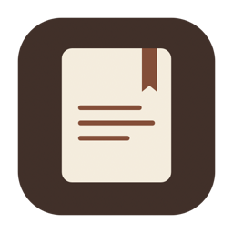
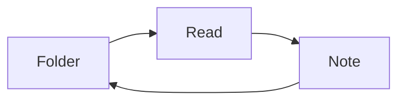

# A place for your project files

Read a little. Follow an idea. Keep your notes close.

Folio keeps the shape of a project intact, from the first Markdown note to the
reference files beside it.

## Start exploring

- Read [Field Notes](Notes/Field%20Notes.md), then try a small edit.
- Browse [the reading list](Data/reading-list.csv) as a table.
- Open [a reference PDF](Reference.pdf).

## Everything stays together

Add a folder from Files to work in its original location. Import an individual
file when you want to keep a copy in Folio.

## A small diagram

## Your next thought

Choose **Edit Document** to make this note your own. Save writes your changes;
Cancel lets you keep editing or discard the draft.
